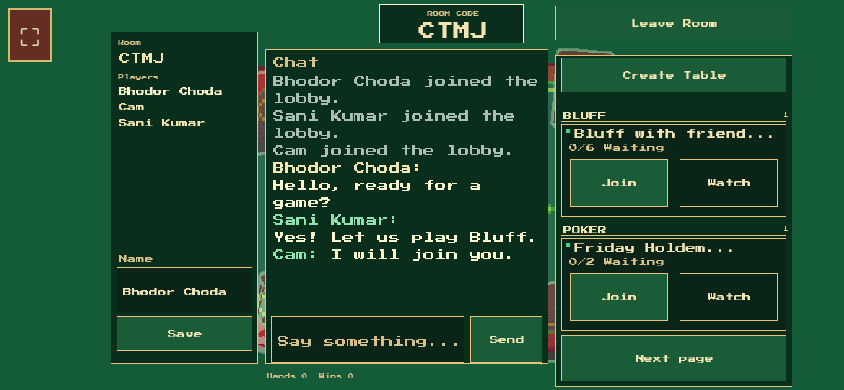
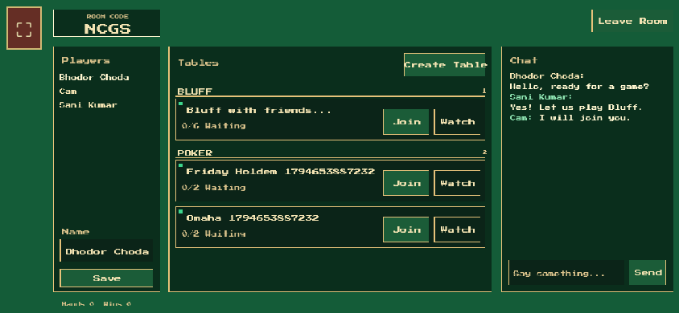
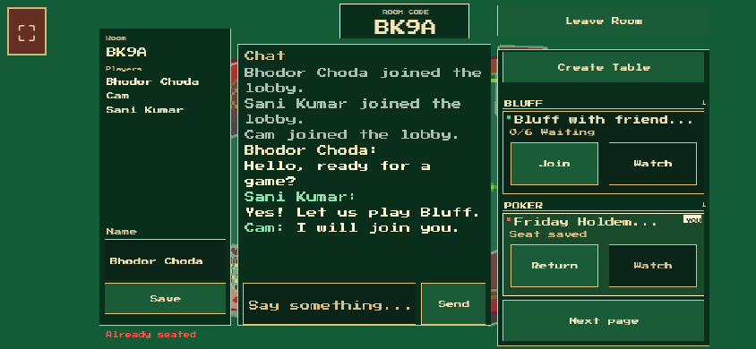
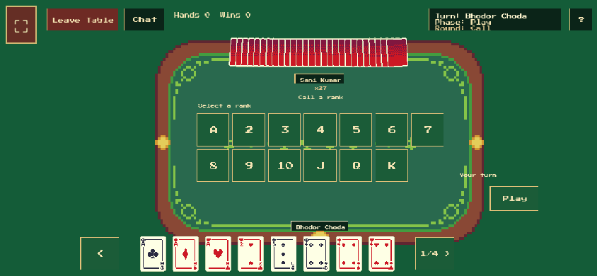
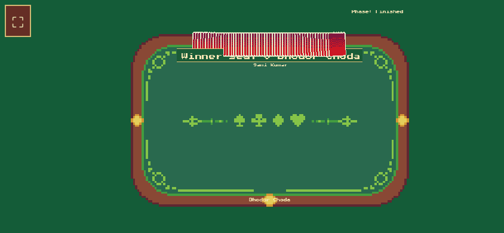
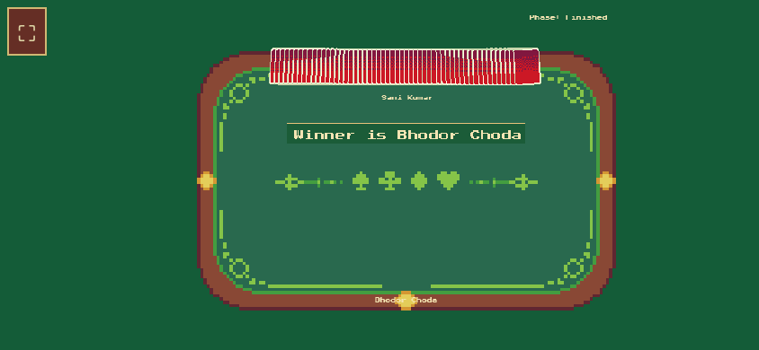

# PR #164 — screenshots and verification

All screenshots were captured from local Cloud instances. `before/` uses baseline commit `b15036e`; `after/` uses this PR. The baseline and fixed servers use separate local databases. The sessions are synthetic test players, not production users.

## Lobby layout

The table browser gets the main column and the extra width on wide screens. Players and a smaller chat panel sit at the edges. Repeated system join notices no longer crowd out conversations. Name/chat inputs remain aligned when the viewport changes. Paging is shown only when needed.

| View | Before | After |
| --- | --- | --- |
| Mobile 844×390 | [Screenshot](before/lobby-mobile.png) | [Screenshot](after/lobby-mobile.png) |
| Wide mobile 932×430 | [Screenshot](before/lobby-wide-mobile.png) | [Screenshot](after/lobby-wide-mobile.png) |
| Desktop 1440×900 | [Screenshot](before/lobby-desktop.png) | [Screenshot](after/lobby-desktop.png) |
| Wide desktop 1920×900 | [Screenshot](before/lobby-wide-desktop.png) | [Screenshot](after/lobby-wide-desktop.png) |

Before:

After:

## Evidence for each reported issue

| Report | Result and screenshot proof | Test proof |
| --- | --- | --- |
| Unused mobile side space and oversized controls | [Before](before/poker-mobile-controls.png) / [after](after/poker-mobile-controls.png). Controls move toward safe edges while the table/cards retain their proportions. | `client/src/table-viewport.test.ts`, `phone-layout.test.ts`; [viewport measurements](supplemental/multiplayer-results.json). |
| Community cards smaller than hand cards | [After mobile](after/poker-mobile-controls.png) / [desktop](after/poker-desktop-controls.png). The resting mobile hand and community cards both use scale 1.25; desktop uses 1. | [Measured equal scales](supplemental/multiplayer-results.json), `phone-layout.test.ts`. |
| Misleading all-in maximum | [Original capped control](before/pot-limit-maximum-mobile.png) / [fixed mobile](after/pot-limit-maximum-mobile.png) / [fixed desktop](after/pot-limit-maximum-desktop.png). Omaha/Oklahoma retain pot-limit rules and say **Pot max** when the full stack cannot legally be wagered. [Hold'em still reaches a full-stack all-in](after/holdem-all-in-maximum.png). | [Baseline renderer values](before/poker-render-fixtures.json); [live maximum values](after/results.json); actual touch/click checks in the browser runs. |
| Own stack hidden by table rail | [Before](before/poker-mobile-controls.png) / [after](after/poker-mobile-controls.png): the bright **Stack** label sits in open green space at lower left, away from Omaha/Oklahoma hole cards and dropped cards. | `phone-layout.test.ts` checks stack bounds against a four-card hand. |
| Betting against the only all-in opponent; extra check turns | [Hold'em](supplemental/holdem-all-in.png), [Omaha](supplemental/omaha-all-in.png), [Oklahoma](supplemental/oklahoma-all-in.png). Outstanding calls are settled, hands reveal, and remaining streets run automatically. Oklahoma retains required discards. | `server/src/poker.test.ts` rejects unmatched bets/raises and checks funded-caller runouts; [live two-player results](supplemental/multiplayer-results.json). |
| Legitimate multiplayer side pots | [Three-player showdown](supplemental/three-player-side-pot.png). Two funded players may still raise after another player goes all-in. | [Side-pot results](supplemental/multiplayer-results.json), with a conserved 3,000-chip total. |
| Turn label flush against buttons | [Before](before/poker-mobile-controls.png) / [after](after/poker-mobile-controls.png). The label-to-button offset grows from 12 to 28 logical pixels, leaving space below the 12-pixel text. | `phone-layout.test.ts`, `table-presentation.test.ts`. |
| Missing clear player-action text | [A raise announced in text](after/poker-action-announcement.png). Poker's latest accepted action stays visible until the next action and clears on a new hand. | `event-messages.test.ts`; actual reducer-driven browser capture. |
| Distracting card-selection/discard outlines | [Yellow selection outline before](before/bluff-card-selection.png) / [lift-only selection after](after/bluff-card-selection.png). Oklahoma's red discard outline is removed, with the lift and a small Drop label retained. | [Matched selection fixtures](before/selection-render-fixture.json) / [after](after/selection-render-fixture.json); [real touch selection](after/results.json); `hand-hover.test.ts`, `poker-driver.test.ts`. |
| Help/status sizing inconsistent across devices | [Mobile header](after/poker-mobile-controls.png) / [desktop header](after/poker-desktop-controls.png); [opened help panel](supplemental/mobile-help.png). Help and status heights match: 44 logical pixels on mobile, 52 on desktop. | `phone-layout.test.ts`, `button-style.test.ts`. |
| Completed poker seats block joining Bluff | [Reproduced baseline “Already seated”](before/poker-leave-blocks-bluff.png) / [players in Bluff after leaving poker](after/joined-bluff-after-poker.png). Finished hands release seats; terminal cash games become finished and empty tables are removed. Old terminal saved-seat reservations are also cleared when joining another game. | [Live terminal-game transition](after/results.json): finished status, zero poker seats, both Bluff joins accepted. [Normal between-hand leave](after/winner-and-between-hand-exit.json) also succeeds with two funded players. `server/src/poker-table-lifecycle.test.ts` covers the lifecycle distinction. |
| iPhone/Safari native selection on long press | [Actual 1.1-second touch hold](after/long-press-card.png). The game surface disables native selection, dragging and callouts, including `-webkit-user-select` and `-webkit-touch-callout`. Editable name/chat inputs remain usable. | [Computed style and blocked default events](after/results.json), `mobile-shell.test.ts`; [working chat input/delivery](supplemental/overlay-results.json). See Safari verification limit below. |
| Bluff winner obscured by cards | [Before](before/bluff-winner-long-hand.png) / [after](after/bluff-winner-long-hand.png). The full winner name is below the opponent fan, at y=190 and z=90, instead of y=112 and z=16. | [Before measurements](before/winner-render-fixture.json) / [after](after/winner-render-fixture.json). `bluff-layout.test.ts` checks full-deck fan clearance and layering. |

## Finished poker → Bluff

The original terminal hand left both players' seats reserved. The baseline capture shows the resulting error:

The fixed live run released both seats, removed the empty finished poker table, and accepted both players into Bluff:

## Bluff winner clearance

These are **matched renderer fixtures** with a 54-card opponent hand. They deliberately stress the overlap from the report; they are not presented as naturally played completed hands. The fixed banner uses the player's name without an internal seat number.

Selection comparison images and the baseline maximum/fold-board comparison also use explicitly recorded renderer fixtures. The fixed maximum, fold reveal, touch selection, and poker-to-Bluff transitions were additionally exercised through real independent browser sessions against SpacetimeDB. The primary baseline seat-error reproduction succeeded; later combined baseline navigation checks timed out, so the deterministic visual fixtures were captured separately.

## Validation and limits

- [Complete automated-test output](automated-tests.txt): **494 client tests passed**, one optional live client test skipped, plus the server and Discord bot suites. Discord's six environment-gated tests were skipped. The browser checks above are separate live local-database tests.
- [Production build output](production-build.txt), TypeScript checks, ESLint, changed-file Prettier and `git diff --check` pass. Full root `pnpm lint` still reports the pre-existing formatting issue in unchanged `src/shared/discord-player-name.ts`.
- Independent two- and three-player browser contexts covered Hold'em, Omaha, Oklahoma, legal side pots, chip conservation, native input alignment/delivery, help, and touch selection/deselection.
- **Safari limit:** the surface protections include Safari-specific CSS, and the browser-default checks passed in Chromium mobile emulation. This Cloud image lacks WebKit's native runtime libraries, so neither native iOS Safari callouts nor a physical iPhone were verified. No screenshot here is claimed to be an iPhone Safari capture.
- No production deployment was performed.

The exact Cloud capture harnesses are included as [live workflow captures](pr-proof.cjs.txt), [normal-hand exit and winner fixture](fixture-proof.cjs.txt), and [matched renderer fixtures](render-proof.cjs.txt). They use the Cloud paths `/workspace/card-house`, `/workspace/card-house-before`, ports 5173/5174, local SpacetimeDB databases `cardroom`/`cardroom-before`, and Playwright with `/usr/bin/chromium`. Run them only against isolated local test databases. `NODE_PATH` can point to a separate Playwright installation; no application dependency was added for these captures.

The `.cjs.txt` files preserve capture scripts as evidence rather than adding them to the application tooling. Copy a capture to a temporary `.cjs` file before executing it with Node and the separate Playwright installation.
